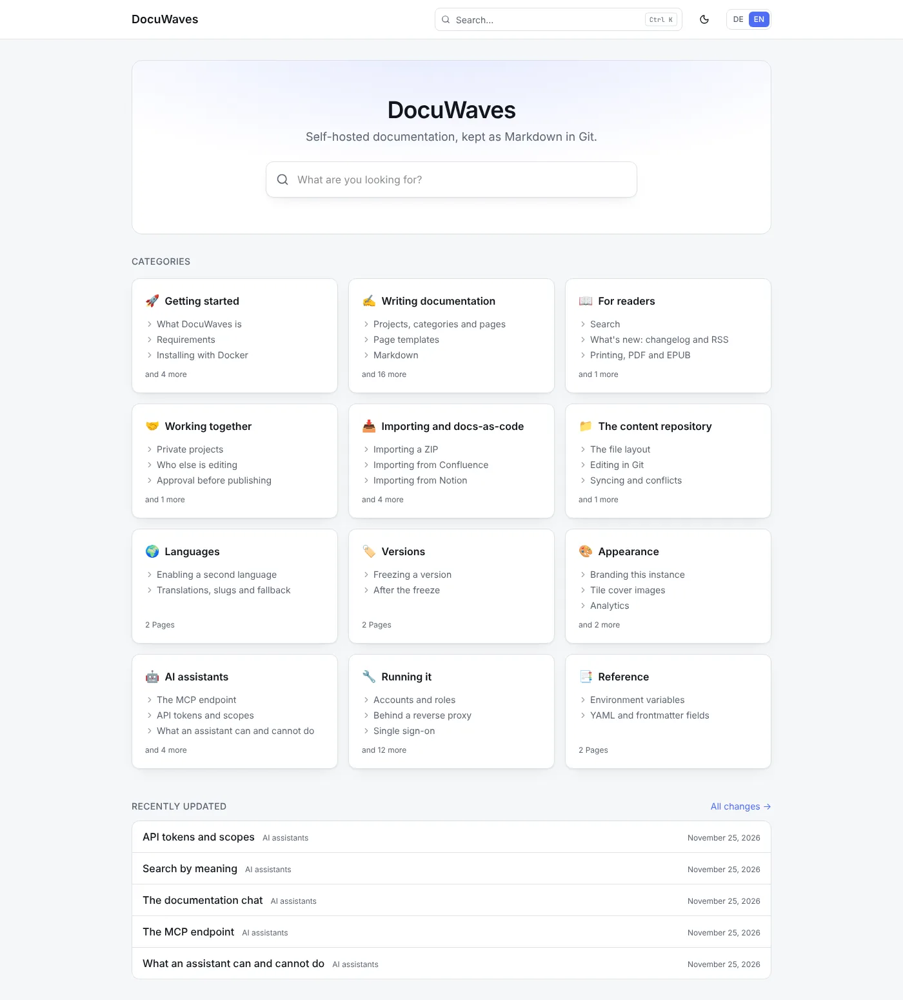
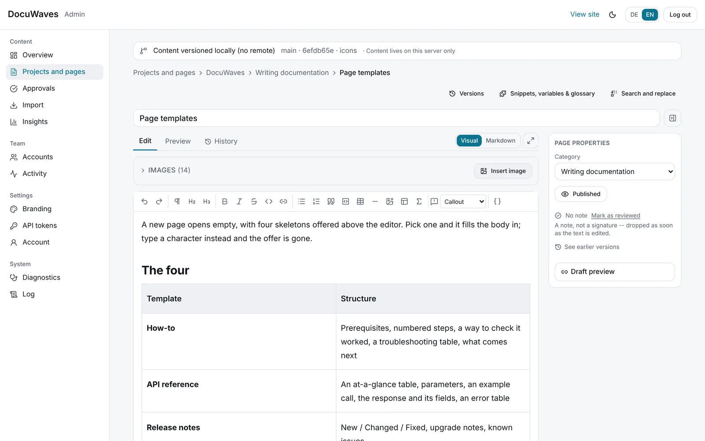
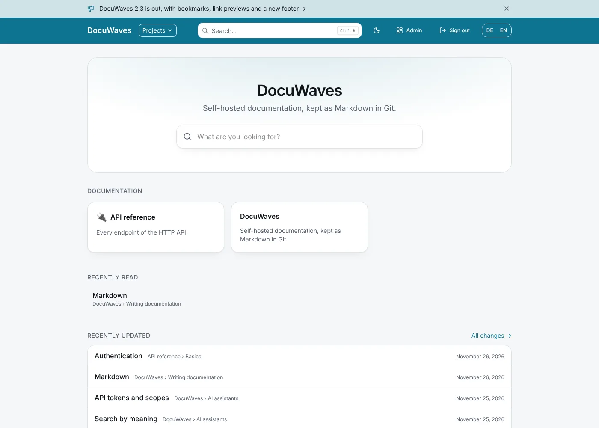
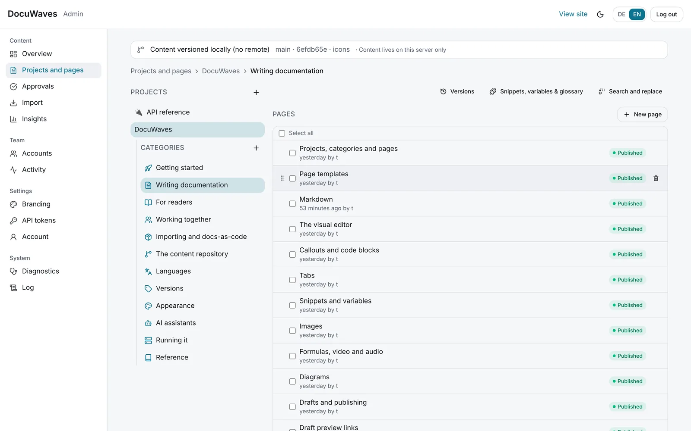

# DocuWaves

A self-hosted documentation CMS. Content is Markdown and YAML files in a Git
repository you control, but it's edited through a real browser UI: the editor
writes the file and commits on save, so nobody has to touch `git` unless they
want to.

**It needs no Git hosting account to run.** Started with no configuration at
all, it creates its own repository inside its data volume, and every page you
write is a real commit with real history. Point it at a remote later (GitHub,
GitLab, your own Forgejo) and that history is pushed there. That is when a
community can start contributing the normal way: fork, edit a `.md` file,
open a pull request.

**Documentation:** [docs.docuwaves.app](https://docs.docuwaves.app). Its
source is the [`docs/`](docs/) folder of this repository.

## What it looks like

| For readers | For writers |
|---|---|
|  |  |
|  |  |

The live documentation at [docs.docuwaves.app](https://docs.docuwaves.app)
runs on DocuWaves itself.

## What it does

- **Many projects in one instance**, each with categories shown as tiles and
  pages in Markdown, with a visual editor or a split Markdown preview.
  [Projects, categories and pages](https://docs.docuwaves.app/p/docuwaves/pages/projects-categories-and-pages)
- **Content lives in Git, not a database.** Every save is a commit, so
  history, diffs, restoring and "who changed this" work with no remote at all.
  The database (SQLite by default, PostgreSQL optional) is only a rebuildable
  index. [The file layout](https://docs.docuwaves.app/p/docuwaves/pages/the-file-layout)
- **Writing tools:** pasted screenshots, Mermaid diagrams, formulas, tabs,
  callouts, snippets and variables, page templates.
  [Markdown](https://docs.docuwaves.app/p/docuwaves/pages/markdown)
- **Drafts, review and approval** before anything is public, draft preview
  links, review notes, and an activity feed.
  [Approval before publishing](https://docs.docuwaves.app/p/docuwaves/pages/approval-before-publishing)
- **Languages and versions, optionally:** translations side by side, and
  documentation frozen at a release while you keep editing the current one.
  [Enabling a second language](https://docs.docuwaves.app/p/docuwaves/pages/enabling-a-second-language),
  [Freezing a version](https://docs.docuwaves.app/p/docuwaves/pages/freezing-a-version)
- **For readers:** full-text search, print and PDF, a changelog with RSS, and
  real link previews and SEO for every page, rendered on the server.
  [Search](https://docs.docuwaves.app/p/docuwaves/pages/search)
- **Accounts with four roles**, password or single sign-on (OIDC), and
  two-factor sign-in with security keys such as a YubiKey, passkeys or an
  authenticator app.
  [Accounts and roles](https://docs.docuwaves.app/p/docuwaves/pages/accounts-and-roles)
- **AI, if you want it:** API tokens and an MCP endpoint so an assistant can
  read and write the docs, and an optional documentation chat for readers.
  [The MCP endpoint](https://docs.docuwaves.app/p/docuwaves/pages/the-mcp-endpoint)
- **Bring existing docs in** from a ZIP, Confluence or Notion, or keep them
  in a code repository and sync them from CI.
  [Docs-as-code](https://docs.docuwaves.app/p/docuwaves/pages/docs-as-code)
- **Branded per instance:** name, logo, colours and footer from one file in
  the content repository.
  [Branding this instance](https://docs.docuwaves.app/p/docuwaves/pages/branding-this-instance)

## Quick start

On a fresh Linux server, the installer sets everything up in one command,
with HTTPS (Caddy and Let's Encrypt), nightly backups and the `docuwaves`
command ([Installing with the installer](https://docs.docuwaves.app/p/docuwaves/pages/installing-with-the-installer)):

```bash
curl -fsSL https://get.docuwaves.app | sudo sh
```

Or by hand with Docker, with no account anywhere and no repository to
create first:

```bash
git clone https://github.com/Syntaxlab-dev/DocuWaves.git
cd DocuWaves
cp .env.example .env     # every line is optional
docker compose up -d --build
```

Open `http://<your-server>:8091` and create the first administrator on the
setup screen. On a server the internet can reach, set `SETUP_TOKEN` in `.env`
first so only you can do that
([The first run](https://docs.docuwaves.app/p/docuwaves/pages/the-first-run)).

Prebuilt images for amd64 and arm64 are published as
`ghcr.io/syntaxlab-dev/docuwaves`, tagged `stable`, `latest`, by version and
by commit. Pin production to a version
([Installing with Docker](https://docs.docuwaves.app/p/docuwaves/pages/installing-with-docker)).

Every setting is an environment variable, listed in
[Environment variables](https://docs.docuwaves.app/p/docuwaves/pages/environment-variables).
Backups and updates are covered in
[Backups and updates](https://docs.docuwaves.app/p/docuwaves/pages/backups-and-updates).

## Development

```bash
cd backend && pip install -r requirements.txt && uvicorn app.main:app --reload
cd frontend && npm install && npm run dev   # proxies /api to localhost:8000
```

Tests: `python -m pytest` in `backend/`, and `npm run build && npm test && npm run lint`
in `frontend/`. See [CONTRIBUTING.md](CONTRIBUTING.md) for how to send a
change, and [SECURITY.md](SECURITY.md) for reporting a vulnerability. A pull
request that changes a feature should change its page in [`docs/`](docs/) too.

What is planned next is in [ROADMAP.md](ROADMAP.md). Questions and ideas are
welcome in [Discussions](https://github.com/Syntaxlab-dev/DocuWaves/discussions).

## License

MIT, see [LICENSE](LICENSE).
